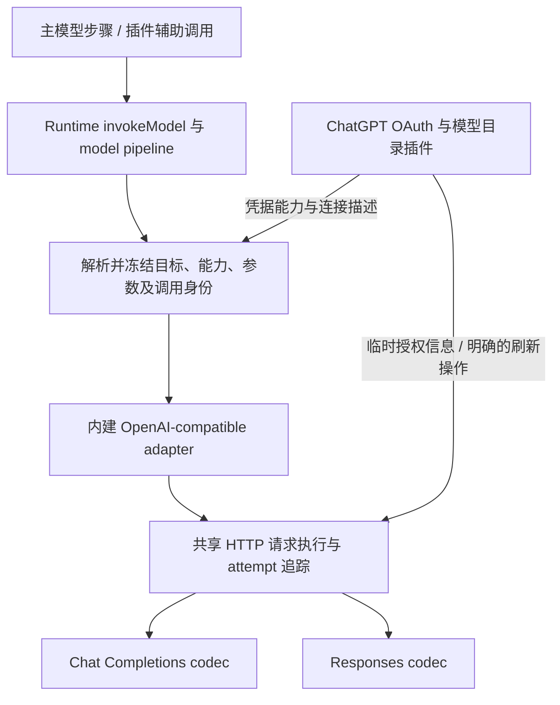

# 模型配置与统一请求路径设计 v1

状态：2026-10-28 独立设计草案，尚未实施。本轮架构修复没有改变模型选择或 ChatGPT 推理请求行为。

## 1. 目标与现状

目标是把 ChatGPT 的推理请求纳入内建 OpenAI-compatible 模型请求实现，插件保留 OAuth 登录、刷新、账户状态和模型目录等账户能力。主步骤、辅助摘要和 Reviewer 继续走同一个 Runtime model stage，不新增执行循环或 Provider 专属 pipeline stage。

当前实现已经共享 `PicoRuntime.invokeModel`，但只共享了上层调度：

| 当前模块                            | 现有职责                                                               | 主要问题                              |
| ----------------------------------- | ---------------------------------------------------------------------- | ------------------------------------- |
| `src/runtime/runtime.ts`            | 模型选择解析、model pipeline、身份记录、主/辅助调用提交                | Thread 持久化身份与实际全局选择不一致 |
| `src/runtime/provider-registry.ts`  | Provider 描述与可执行 handler 注册                                     | 账户身份、协议和执行实现绑定在一起    |
| `src/runtime/model.ts`              | Chat Completions 编解码、HTTP、流解析、usage 与诊断                    | HTTP 和协议职责混合                   |
| `src/plugins/chatgpt-plan/model.ts` | Responses 编解码、HTTP、OAuth 401 刷新、传输重试、流解析、usage 与诊断 | 插件维护第二套完整推理请求实现        |
| `src/plugins/chatgpt-plan/auth.ts`  | OAuth 与模型目录                                                       | 这些能力适合继续独立于推理协议        |
| `src/plugins/model-parameters`      | 能力校验、参数控件与 wire 参数映射                                     | 参数归属需要与目标解析顺序一致        |

当前 `threadModelSelection` 会合并全局 provider/model 与 Thread 参数；`updateThreadModelSelection` 主要更新参数，但公开类型仍接受完整模型身份。旧 Thread 视图保存的 provider/model 可能与真实请求不同。后续实现必须明确解决这个契约，而不能继续忽略部分输入字段。

## 2. 统一请求实现，保留协议差异

内建 OpenAI-compatible 能力应同时承载 Chat Completions 和 Responses 两种协议。ChatGPT 连接选择 Responses codec，普通 API-key 连接可按其声明选择协议；不得直接把 ChatGPT 请求改发到 `/chat/completions`。

这次合并只收敛 OpenAI-compatible 请求实现，保留现有第三方自定义 `ModelProvider` handler 的注册和分发能力。自定义协议继续经过同一个 model stage，由 registry 分发到其 handler；下面的 codec 选择规则仅适用于声明使用内建 adapter 的连接。

官方迁移文档明确区分请求端点、输入和输出结构；Responses 的函数调用及状态携带也有独立表示。因此，协议编解码需要分别实现。[OpenAI Responses 迁移指南](https://developers.openai.com/api/docs/guides/migrate-to-responses)

建议的内部拆分如下。共享部分必须只有一份可执行实现，不以两套 adapter 外加一个转发壳代替迁移。

- **请求执行器**：HTTP 发送、取消、超时、重试预算、401 刷新协调和每次物理请求的诊断终结。
- **SSE 帧读取器**：字节解码、帧边界、跨 chunk 拼接与 reader 清理；不解释模型事件语义。
- **Chat Completions codec**：消息、工具和图片序列化，choices/delta、结束标记与 usage 解析。
- **Responses codec**：input/output items、工具调用、reasoning replay、图片及语义流事件处理。
- **统一结果契约**：继续返回现有 `ModelResponse` / `ModelStreamEvent`；Runtime 独占 Execution 与 Assistant 提交。

Responses 使用具名语义事件，不能直接复用 Chat Completions 的 chunk 解释器；可复用的是底层 SSE 帧读取和请求生命周期。[OpenAI 流式响应指南](https://developers.openai.com/api/docs/guides/streaming-responses)

首阶段以移动既有 Responses 实现并保持行为为主，后续再消除重复解析辅助函数。保留当前完整 PromptTurn 回放方式与 `store: false`，不同时改用远端 conversation/previous-response 状态。

## 3. 配置、连接、协议与凭据分别归属

建议使用以下概念，先保留当前两种默认连接，不增加账户/Profile 管理产品：

| 概念            | 保存内容                                                                                   | 所属边界                                     |
| --------------- | ------------------------------------------------------------------------------------------ | -------------------------------------------- |
| 连接描述        | 稳定 connectionId、显示 Provider、endpoint、protocol、credential owner/reference、能力来源 | Runtime 配置；无原始凭据                     |
| 当前模型目标    | connectionId 与 model                                                                      | 全局模型设置；是否允许 Thread 固定覆盖见下节 |
| Thread 参数覆盖 | temperature 与经校验的语义选项                                                             | Thread 配置事实                              |
| 有效请求选择    | 实际 connectionId、Provider、protocol、model、有效参数及配置修订                           | 每次逻辑调用冻结后的非敏感身份               |
| 凭据            | API key、OAuth token、刷新状态与授权锁                                                     | 既有 private secrets / 专用 OAuth 存储       |
| 模型目录        | 模型标识、展示属性与可用能力                                                               | 插件 cache；不是执行身份或恢复事实           |

内建 adapter 中，Provider 显示名不再决定使用哪段请求代码；protocol 决定 codec，credential owner 决定授权来源。失效连接、停用的凭据插件或不支持的参数应明确失败，不回退到另一个连接。

插件只需声明其连接使用内建 Responses 协议，并提供授权与模型目录能力。授权函数只接收连接、目标 endpoint、signal 和是否强制刷新等必要信息，不接收完整 prompt，不负责发送推理 HTTP 请求。OAuth token endpoint 请求仍由 OAuth 插件负责。

授权信息只在请求进程内短暂使用。最终 endpoint 确定后，按连接允许的来源绑定授权；model interceptor 修改目标时，不得携带原目标凭据跨 endpoint。诊断和 Canonical 只记录非敏感连接身份，不记录原始 headers、token 或凭据指纹。

带授权的推理请求默认拒绝 HTTP 重定向。确有连接需要重定向时，必须逐跳验证目标并重新决定可携带的授权，不能只校验初始 URL 后依赖 fetch 自动跟随。

## 4. 模型选择策略需要显式定案

建议第一阶段保持当前“provider/model 跟随全局，参数允许 Thread 覆盖”的产品行为，修正其读写契约，不自动恢复旧设计中的固定模型语义。

- 将读取返回值明确命名为有效选择；写入 Thread 的接口只接受参数覆盖。传入不属于该接口的 provider/model 应明确拒绝，不能继续悄悄忽略。
- 全局修改作用于之后创建的逻辑模型调用；已开始的调用与其物理网络重试沿用冻结目标、prompt、协议及参数。
- 用户主动 Retry 是新的逻辑调用，可以解析当时的新配置；保存 `retryOf` 关联。
- Child 继承 Thread 参数时仅复制当前有效目标支持的参数；父配置之后变化不重写已创建 Child 的覆盖值。
- 若需要“每个 Thread 固定模型”，再引入明确的 inherit/fixed 选择策略。读取、更新、Child 继承和 UI 必须一起表达该策略，不能靠旧视图中是否恰好有 provider/model 推断。

这里仍是建议，不是本轮已实施决定。另一条可选路线是恢复 Thread 创建时固定身份，但它会改变近期全局选择行为，必须在实现前明确选择。

历史迁移以版本化新事实保存参数覆盖和已选策略，保留旧 Canonical 记录。旧 Thread 视图中的身份不应被自动当成用户明确固定的选择。模型选择事实、请求身份事实、API 类型和测试断言在同一阶段迁移。

### 辅助调用的幂等与最终请求身份

当前 `preparePluginModelCall` 在 model pipeline 之前计算 `requestFingerprint`，而最终目标、prompt 和 wire 参数可能由 interceptor 修改。实现时必须分别说明「接受了哪个逻辑操作」与「最终执行了哪个请求」，不能将早期指纹描述为最终请求身份。

建议采用两层身份，作为配置契约的一部分定案：

- `submissionFingerprint` 表示调用方显式提交的意图，包括 plugin、Thread/Project、purpose、原始 prompt、显式目标或继承标记以及显式参数。同一 key 的不同显式意图冲突；接受记录、指纹、配置快照和 `(pluginId, key)` 的占用必须原子化，相同意图的并发请求共享同一个运行中操作，不能启动两次 pipeline。
- 首次接受操作时保存所用配置快照。model pipeline 只运行一次，在最终 dispatch 前冻结 `resolvedRequestFingerprint`，覆盖最终连接、协议、model、prompt、有效参数和所用配置修订，并与接受记录关联。主调用与辅助调用共享这个冻结环节。未到达 dispatch 的短路完成或失败允许没有最终请求指纹，需记录其结果来源，不能伪造网络 attempt。
- 相同 key 与提交意图重放首次完成结果，不因之后全局配置或 interceptor 变化重新请求；要使用新配置执行新操作，调用方必须使用新 key。失败或重启遗留的未完成操作保留显式状态，不能自动以新配置重跑。
- 同次逻辑调用的物理网络重试使用同一冻结身份，不重新进入 model pipeline；提交内容和身份摘要不得扩大现有持久化敏感数据范围。重启时 running/dispatched 但无持久化结果属于结局未知，标记 interrupted/unknown 并要求新 key；已记录失败或中断也要求新 key，不自动重试。
- signal 与事件回调不属于提交指纹。建议只有首次接受请求的 signal 控制共享操作；后到请求只等待最终结果，其取消仅取消自己的等待，不中断共享调用，也不补发实时事件。这一行为必须写入插件 API 契约并测试。

该建议与当前混用有效选择和提交意图的单指纹语义有差异，必须版本化迁移。旧记录缺少可靠的原始意图时不能猜测可重放身份，应保持旧版校验或要求新 key。若产品选择「当前有效配置相同才可重放」，则需先定义可复用的纯解析契约，让幂等校验与 dispatch 使用同一结果；不得为探测身份而执行任意 model interceptor 两次。

## 5. 重试、流与诊断的不变量

共享实现不意味着所有连接采用相同重试策略。迁移先保持当前行为，再单独评估策略统一：

| 情况                                          | 第一阶段行为                                                                                             |
| --------------------------------------------- | -------------------------------------------------------------------------------------------------------- |
| ChatGPT 请求尚未收到响应的已知 fetch 传输失败 | 保留当前最多五次重试、两秒间隔；401 刷新前后共享这五次预算，等待支持 AbortSignal                         |
| 普通 API-key 请求                             | 不因抽取执行器而自动增加重试                                                                             |
| OAuth 401                                     | 由执行器调用授权能力强制刷新一次，再发一个有独立 attempt 的请求；再次 401 失败，不刷新或重置传输重试预算 |
| 已收到响应后的流中断、解析失败或部分输出失败  | 不自动重新生成整条回复                                                                                   |
| 主动 Interrupt                                | 传播同一取消意图，终止等待与请求，禁止之后提交 Assistant                                                 |
| Responses completed 但没有文本或工具          | 保留当前合法空响应语义                                                                                   |

每个真实 HTTP attempt 必须恰好 started 一次、settled 一次，覆盖 fetch 抛错、HTTP 拒绝、reader 失败、取消和成功完成。OAuth 请求单独标注授权阶段，不计作第二次模型逻辑调用。保留当前 Fast、usage、首字延迟、reasoning、工具预览、终结事件和错误白名单；避免 Runtime 再根据某个协议字符串猜测失败阶段。

因此一次 ChatGPT 逻辑调用最多包含初始请求、五次传输失败重试和一次 401 后重发；OAuth token HTTP 请求不属于这个模型请求计数。

缓存/session 标识从明确的调用作用域生成：主 Thread 与插件辅助调用保持各自稳定身份；保留现有 `prompt_cache_key`、session/thread headers 的适用语义，由连接描述控制是否启用。不能把这些字段硬编码为所有 OpenAI-compatible 服务的要求。

reasoning replay 保持 opaque：由对应 codec 解释，Canonical 与 Projection 透明传递；跨协议或不兼容模型时应明确处理能力不匹配，不能把不支持的 replay 当普通用户文本发送。

## 6. 分阶段实施与独立提交

1. **定案配置契约**：选定全局/Thread 策略及辅助调用幂等语义，定义有效选择与参数写接口、冻结身份的公共环节，迁移历史视图及指纹版本，更新与该策略矛盾的测试。此阶段不移动请求实现。
2. **提取共享 HTTP/SSE 基础实现**：以现有 Chat Completions 行为验证请求、取消和诊断；无实际模型调用行为变更。
3. **迁入 Responses codec**：把 ChatGPT 模型文件中的通用请求/解析逻辑移入 core adapter，实现 API-key + Responses 的可测试组合；通过本地 fake server 验证协议与授权解耦。
4. **改接 ChatGPT 连接**：插件只注册 OAuth、连接描述和模型目录能力；主/辅助调用均进入内建 adapter。移除旧 `ChatGptResponsesAdapter` 与插件推理 HTTP 发送实现，禁止长期双路径。
5. **收拢通用模型 UI**：模型选择和能力参数面板消费统一契约；ChatGPT 专属页面保留登录、账户与目录刷新。校验目录缓存失效、插件停用和 UI 迟到响应。
6. **回归与独立验收**：每阶段只提交对应源码、测试与必要生成产物；整个阶段不默认部署生产服务。

## 7. 验收矩阵

- 两协议分别覆盖普通文本、并行函数调用、完整 call/result 配对、多模态结果、reasoning 与 usage；相同领域输入保持有效模型结果语义。
- Responses 覆盖 completed-empty、流未完成、工具参数分片、reasoning replay、错误正文脱敏；Chat Completions 保留现有兼容处理。
- API-key/OAuth 与主/辅助调用交叉测试；Core Responses codec 不依赖 ChatGPT auth 类。
- 已有自定义 ModelProvider 继续经过同一个 model stage 分发，不强制进入内建 OpenAI-compatible adapter。
- 验证 401 刷新恰好一次、刷新前后共享传输失败预算、再次 401 失败、流中断不重放、退避取消，以及每个物理 attempt 终结一次。
- model pipeline 改目标后，实际 endpoint、授权来源、参数、记录身份一致；错误连接、已停用插件、跨 endpoint 授权及未经允许的重定向明确拒绝。
- 辅助调用覆盖同 key 并发去重、显式请求变化冲突、配置/interceptor 变化后的重放、短路、重启未完成记录和旧指纹迁移；pipeline 不因身份校验重复运行。
- Thread/global 选择策略、Child 幂等创建、网络重试冻结身份、主动 Retry、重启及 Canonical 视图重建保持一致。
- 使用合成凭据哨兵检查 Canonical、公开 Snapshot、plugin state、错误及诊断；测试只使用临时数据库和本地 fake server。
- 基线失败按原因单独核对；本轮保留的模型选择契约失败必须在配置定案阶段转为真实验收用例，不通过删除断言或任意跳过规避。

## 8. 设计验证范围

本草案核对了本地 Runtime、Provider registry、两个模型实现、OAuth/模型目录与参数插件；官方资料仅用于确认公开 Chat Completions/Responses 协议差异。没有验证具体 ChatGPT 账户的授权范围、端点可用性或生产能力，不把共享协议推断为所有账户都可调用所有端点。

实施前仍需定案：模型选择采用全局继承还是显式 Thread 固定；辅助调用采用提交意图幂等还是当前有效配置幂等；现有连接到新 connectionId 的迁移规则；各连接的 replay/参数能力边界。建议先保留当前公开连接身份与实际行为，通过版本化迁移逐步收敛。
