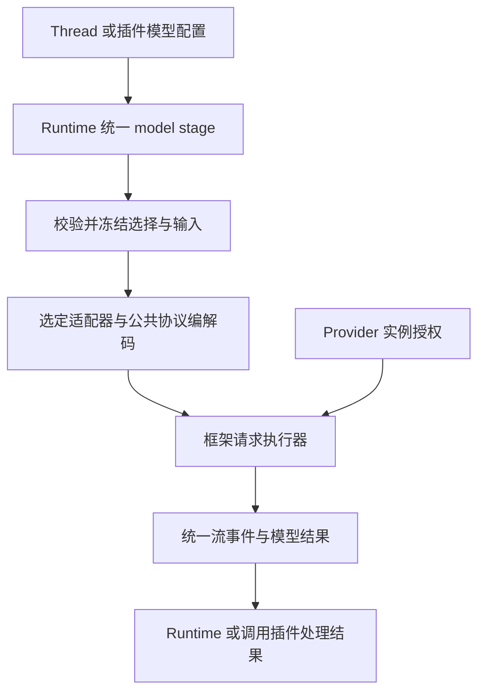

# 模型目录、适配器与统一请求路径设计 v2

状态：2026-10-28 用户确认的设计已分阶段实现并验证；尚未部署。此文替代 v1 中全局模型选择及 Provider 绑定适配器的建议。

## 1. 职责

| 组件                  | 职责                                                                               |
| --------------------- | ---------------------------------------------------------------------------------- |
| Provider 插件         | 注册 Provider 类型及添加页面，管理授权与模型发现，通过框架接口添加和移除自己的实例 |
| Provider 实例         | 一个独立账户或连接；稳定标识、配置、专属凭据与目录缓存                             |
| 模型目录              | 汇总实例下的模型、协议、来源及可用状态，同名不同来源分别注册                       |
| 适配器插件            | 注册匹配条件、参数定义、校验、请求差异和 reasoning replay 逻辑                     |
| 选择器                | 用户先选模型，再从右侧菜单中选择匹配的适配器并配置参数                             |
| Thread / 插件调用配置 | 保存模型注册标识、适配器标识和参数                                                 |
| 框架执行层            | 统一协议编解码、HTTP、SSE、取消、重试、诊断及 usage                                |
| Runtime               | 调度执行、维护 Execution，并提交主对话 Assistant 和工具调用                        |

同一个插件可以同时注册 Provider 与适配器，两项贡献独立；Provider 不知道适配器。适配器不自行发送推理请求或维护重试循环。

## 2. Provider 多实例

设置页不再切换全局 Provider/model，而是管理 Provider 实例列表。

添加流程：点击添加 Provider → 选择插件注册的类型 → 打开插件提供的添加页面 → 登录或填写配置 → 框架创建实例 → 发现模型。

同类型可以添加多次。实例有独立凭据、刷新协调和目录缓存。插件只能操作自己拥有的实例；框架负责持久化、唯一标识、归属校验及统一展示。连接配置不含原始凭据，公开目录不能暴露 headers、token 或带授权的 URL。

删除实例使其模型不可用，历史调用记录保留。停用插件只让相关贡献不可用，保留实例配置以便恢复。目录刷新失败保留缓存并标记状态异常，不直接视为模型下架。

## 3. 模型与适配器选择

模型选择器汇总所有实例的模型，不再先选 Provider。点击模型后，右侧展示所有兼容适配器的名称、来源和说明；选定后由框架生成参数面板。

即使只有一个候选也由用户明确确认。多个匹配结果属于正常候选，不按注册顺序或数字优先级选出赢家。重复适配器标识属于注册错误。

适配器采用结构化匹配条件，例如模型名、家族前缀、协议及必要的连接约束。匹配只决定候选集合，保存的选择决定实际启用哪个处理器。

选择结构：

```ts
interface ModelSelection {
  modelId: string;
  adapterId: string;
  parameters: {
    temperature?: number | null;
    options: Record<string, string | number | boolean>;
  };
}
```

模型注册标识包含具体实例归属；不能仅保存原始模型名。模型、适配器和参数整体校验、整体保存。菜单草稿不立即改变 Thread。

新 Thread 初始为 Choose model。模型确认不可用时恢复该状态；适配器不可用或不再匹配时要求重选；旧参数失效时明确提示，不静默丢弃或回退。新增适配器不改变已有选择。

## 4. 参数与适配器接口

框架定义适配器接口，覆盖匹配、参数描述、默认值、校验、序列化、模型专属输入/结果处理及 replay 兼容性。参数 UI 和存储属于框架，模型知识可由插件独立发布。

参数枚举、范围和默认值使用数据定义；复杂序列化和 replay 使用独立逻辑。一次调用选择一个适配器，不隐式拼接多个候选；显式公共逻辑复用允许。

适配器注册在独立 registry，公共 model pipeline 在固定节点按需调用。各适配器不进入全局 middleware 链自行判断是否生效。

## 5. 统一执行路径



内建协议分别支持 Chat Completions 与 Responses，共享 HTTP 生命周期及 SSE 基础读取。ChatGPT 请求迁入框架 Responses 实现，插件只保留账户、OAuth 与目录。第三方扩展遵守同一调用和诊断契约。

每次逻辑调用冻结所选连接、模型、适配器、prompt 和参数。配置修改只影响新调用；物理重试不重新选择模型或进入 pipeline。model interceptor 不得悄悄更换用户保存的组合。

迁移保留当前请求语义，包括完整 PromptTurn 回放、store:false、缓存/session 作用域、Fast、工具预览、usage、合法 completed-empty 和安全错误分类。

重试先保留连接现有策略：ChatGPT fetch 传输失败最多五次重试、两秒间隔，401 刷新前后共享预算；401 强制刷新最多一次；普通 API-key 不自动增加重试。流或解析失败不自动重新生成完整回复。授权绑定最终 endpoint，带授权推理请求拒绝未经批准的重定向。

## 6. 统一观测

框架采集标准文本、推理、工具、usage 和完成事件，统一记录每个物理 attempt 的开始和终结。

首字延迟从请求发送计至第一个非空用户可见文本增量，推理和工具参数另行处理。端到端输出吞吐以可靠 outputTokens 除以完整物理请求耗时，包含首字等待；不将其冒充首字后生成速度。缺少可靠 token 数据时不生成 TPS。非流式响应不伪造流式首字时间。

## 7. 子 Thread 与插件调用

spawn_thread 工具可显式指定完整 ModelSelection，框架在创建前校验并与创建一起保存。未指定时复制父 Thread 当时的完整配置，之后独立。提供模型/适配器/参数查询能力供工具使用。

插件调用在框架中独立配置：使用所属 Thread，或使用插件固定的完整选择。默认使用 Thread。摘要与标题等只提交任务输入，不自行请求 Provider，也不偷偷选择其他模型。首期不隐式覆盖已选参数。

插件调用保持幂等：同 key 的相同提交共享进行中操作或重放首次结果；不同显式意图冲突。首次接受时冻结配置，保存最终实际请求身份；配置变化需要新 key 才执行新调用。失败、取消或重启结局未知时不能自动重发。pipeline 短路允许没有物理 attempt。

## 8. 历史与 replay

Canonical 及投影透明保存 replay 数据与格式来源；Rolling Context 不解释模型专属字段。执行时由框架根据适配器声明检查兼容性，并由对应逻辑编码。不兼容数据不得无条件发给新模型；缺少协议必需内容时明确失败。历史记录不因切换或卸载插件而重写。

## 9. 迁移与阶段提交

1. 公共契约、实例目录和适配器基础。
2. Provider 插件多实例与独立适配器注册。
3. Thread、子 Thread 与插件调用配置及 API。
4. 通用选择器、Provider 添加页与参数 UI。
5. 统一协议请求实现并移除旧推理路径。
6. 历史迁移、回归和范围审计。

旧连接迁为可识别实例，旧 Thread 只有能可靠映射完整选择时才迁移；无法确定时保持 Choose model，不批量套用当前全局选择。保留旧 Canonical、replay 和无关工作区修改。

每阶段执行针对性验证后独立提交，最终完整构建和回归。基线失败按原因比较；与新契约冲突的旧测试改为真实新行为验收，不通过删除或跳过规避。测试使用临时数据库和模拟服务，不调用真实模型、不操作生产账户，本次不自动部署。

## 10. 实施与验证记录

| 提交 | 内容 |
| --- | --- |
| `23cfacc` | Provider 实例目录、独立适配器注册与显式选择契约 |
| `cf31504` | 框架共享协议传输、请求生命周期及诊断 |
| `8cc7933` | Thread/插件/子 Thread 配置、Provider 多实例、ChatGPT 请求迁移、旧推理注册路径移除 |
| `3b302b3` | 通用模型选择器、右侧适配器与参数菜单、Provider 添加页、框架 TPS 展示 |

后端提交的隔离快照通过类型检查和 31 项定向测试；界面提交的隔离快照通过完整构建、ESLint 和 12 项定向测试。浏览器验收使用临时数据库与匿名手动模型，确认同类 Provider 可多次添加、同名模型按实例区分、明确选择适配器、参数保存及刷新恢复，最终浏览器无告警。

最终隔离快照全量回归为 95 个测试文件、405 项测试：389 通过、16 失败。重构前基线为 367 项、26 失败；逐项比较失败用例及原因，没有新增失败，原有失败减少 10 项。因此不能将此次验证描述为全套测试通过。构建仍有既有前端 bundle 超过 500 kB 的提示。

未进行真实模型调用、生产 OAuth 验收或部署；原有部署相关工作区修改未纳入这些提交。旧 Thread 无法可靠确定完整模型与适配器组合时会要求重新选择。
